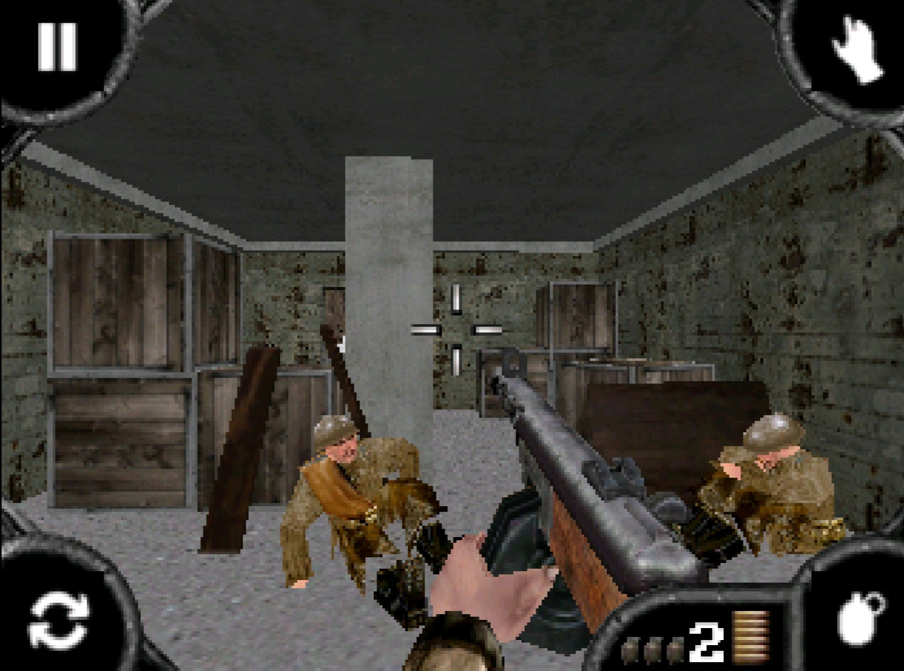

<!--
Copyright (C) 2026 PocketHLE Emulator Project
SPDX-License-Identifier: Apache-2.0 OR MIT
-->

# PocketHLE

  

  A high-level Windows Mobile / Pocket PC / Gizmondo emulator for Linux, Windows and Android.

  

  <strong>Join our Discord for development updates, compatibility discussions, support and community chat.</strong>

[Русская версия → `README.ru.md`](README.ru.md)

---

> [!NOTE]
> PocketHLE targets native ARM Windows CE / Windows Mobile executables packaged in `.CAB` archives. It is experimental software: compatibility, performance and input behavior vary by game and host platform.

> [!WARNING]
> PocketHLE is developed for research and educational purposes. It does not include Microsoft system files, firmware or game data. Use only legally obtained game copies and archives.

## Info

PocketHLE is an early-stage high-level emulator for Pocket PC 2002/2003 and Windows Mobile 5/6 games. Instead of emulating a complete Windows CE device, it loads the original game executable, runs its ARM code through a CPU backend, and provides clean-room host-side implementations of the Windows CE APIs the game expects.

The project is inspired by [touchHLE](https://github.com/touchHLE/touchHLE) and [EKA2L1](https://github.com/EKA2L1/EKA2L1), with a launcher and library workflow influenced by [j2me-loader](https://github.com/nikita36078/j2me-loader).

## Games Tested

| Asphalt 4 Elite Racing | Call of Duty 2 |
| :---: | :---: |
|  |  |

| Zuma Deluxe | Bejeweled |
| :---: | :---: |
|  |  |

Here is a version of PocketHLE that’s tailored for the Gizmondo [PocketHLE by guizmox](https://github.com/guizmox/PocketHLE)
