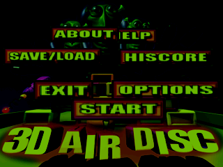
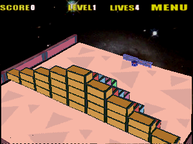

# 3D Air Disc v1.02 — Windows Mobile proof

The provided ARM CAB now reaches gameplay in PocketHLE. Startup creates and opens the title's CEDB properties database and writes its two initial properties; the previous zero-return stubs caused the game's own “Can not write in prop-a” fatal dialog.

The guest must stay at 240×320 portrait. The game draws landscape artwork into that panel, so the library assigns `RotationPref::Cw90` on import. Forcing a 320×240 guest screen instead triggers the game's `GraphicBuffer::BlitRight` fatal dialog. These screenshots show the normal clockwise landscape presentation:

## Validation

- `cargo fmt --all -- --check` — passed.
- `cargo test --workspace` — 446 passed, 10 ignored, 0 failed.
- `cargo clippy --workspace --all-targets` — passed without warnings.
- `cargo build --release -p pocket-cli --features unicorn` — passed.
- `tools/ai-tap-sequence.py` with the user-supplied CAB, `--message-budget 0`, `--max-slices 20000000`, taps at frames 1 `(120,160)`, 20 `(155,140)`, and 55 `(120,160)`, and `--max-frames 100` — exit code 0; the title menu and Level 1 gameplay rendered; final `frame_counter=102`; no fatal or unimplemented-call messages. CEDB create/open/write calls returned valid IDs.

Validation ran in PocketHLE's ARM/Unicorn emulator, not on physical Windows Mobile hardware. This container has no audio device, so PocketHLE fell back to silent mode. The provided game archive is not included in this repository.
