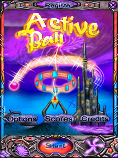
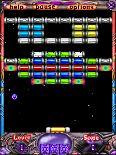

# Active Ball v1.8 (ARM) compatibility proof

The supplied ARM CAB was tested in PocketHLE's ARM/Unicorn emulator. The installer and game binaries are not included. This validates PocketHLE emulation, not a physical handset or Microsoft's Device Emulator.

## Diagnosis and fix

On unmodified `main`, the game stopped before window creation: its ARM CAB called the unimplemented `coredll.dll!_strlwr` 347 times while indexing packed resources, then faulted reading address zero with `frame_counter=0`. After `_strlwr` was handled, startup reached the private `imagelib_ce.dll` imports. The bundled 693-byte `system.png` contains complete PNG image data but no terminal `IEND` chunk, which the host decoder requires. The fix implements `_strlwr`, `IMG_LoadImageStream`, and `IMG_GetLastError`; it supports PNG/JPEG decoding and appends `IEND` only to an otherwise complete PNG stream.

## Automated run

`tools/ai-tap-sequence.py` ran against the ARM CAB with PocketHLE's default 240-message budget. The script scheduled a Start tap at frame 469, then playfield taps at frames 1200 and 2600. It exited successfully, reported `frame_counter=4139`, wrote 80 sampled frames, and reached gameplay without a CPU fault. The host has no ALSA output device, so the game ran silently; this did not affect rendering or tap handling.

Rust validation also passed: `cargo fmt --all -- --check`, `cargo test --workspace` (448 passed, 10 ignored, 0 failed), and `cargo clippy --workspace --all-targets`.

Full sanitized output: [ai-tap-sequence.log](./ai-tap-sequence.log).

## Screenshots

## References checked

The repository is the Rust/Unicorn emulator, not an original Windows Mobile SDK project; the supplied game is an ARM Windows CE executable. API semantics were checked against Microsoft's [Windows CE 5.0 Standard SDK](https://www.microsoft.com/en-us/download/details.aspx?id=17310), archived [GAPI](https://learn.microsoft.com/en-us/previous-versions/aa457625(v=msdn.10)) and [WinMain](https://learn.microsoft.com/en-us/previous-versions/windows/embedded/ms914104(v=msdn.10)) documentation, and the 2009 [GAPI compatibility note](https://blogs.windows.com/windowsexperience/2009/07/14/just-say-no-to-gapi-what-you-need-to-know-about-allkeys-and-input-management/). The historical [Windows CE forum discussion of `gx.dll`](https://forum.fs-net.de/index.php?thread%2F2090-gx-dll-on-target%2F=) confirms GAPI availability varied by target. Global GitHub code search found a working [xnp2 GAPI implementation](https://github.com/nonakap/xnp2/blob/9a0baa69548cfa00c9f57ba26be8fc54e8f55272/wince/gx/gx.cpp) and a CRT [`_strlwr` implementation](https://github.com/cansou/msvcrt/blob/cbbce9b9b1617bee5df6dbba7fb8d99a9174b66c/src/strlwr.c). The GAPI path in PocketHLE already matches the conventional setup/present flow; the failure occurred before it was entered.
