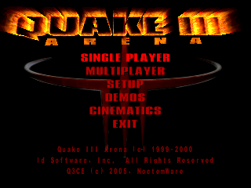
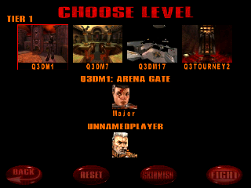
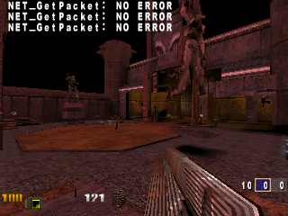

# Quake3CE gameplay verification

Verified on 2026-10-18 with PocketHLE's ARM/Unicorn backend at 320×240 landscape.

The `ai-tap-sequence.py` run selected **Single Player → Fight → Fight**, captured 30 changed frames, reached the live match (`frame_counter=4654`), and exited cleanly. No unimplemented Windows API calls appeared in the final run. The only host warnings were ALSA reporting that this headless machine has no audio device.

The supplied ZIP contains `q3ce.exe`, `q3ce_mem.cfg`, and the three `baseq3` DLLs, but no `pak0.pk3` or `pak1.pk3`. The local gameplay fixture added those separately held Quake data packages; the executable, configuration, and DLLs were SHA-256 verified against the supplied archive. The PAKs are deliberately not included in this PR.

The emulator did pause at the local-server startup while the frame counter was at 2601; the tap helper released the scheduled input, then the game resumed and reached combat. This verifies the HLE run, not a physical Windows Mobile handset.

The gameplay command used the same input sequence:

```bash
python3 tools/ai-tap-sequence.py <private Quake3CE fixture ZIP> \
  --pockethle target/release/pockethle \
  --screen 320x240 \
  --tap 600:160,76 --tap 1600:285,221 --tap 2600:285,221 \
  --message-budget 0 --max-slices 30000000 \
  --instructions-per-slice 20000 \
  --dump-frames-to <output-dir> --dump-frame-stride 100 --max-frames 30
```

Build and checks:

- `cargo build --release -p pocket-cli --features unicorn` — passed
- `cargo test --workspace` — 468 passed, 0 failed, 10 ignored
- `cargo clippy --workspace --all-targets` — passed
- `cargo fmt --all -- --check` — passed

## Screenshots






